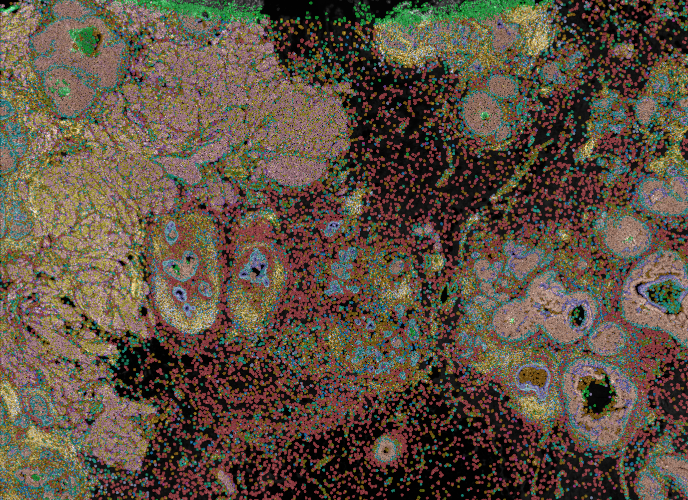
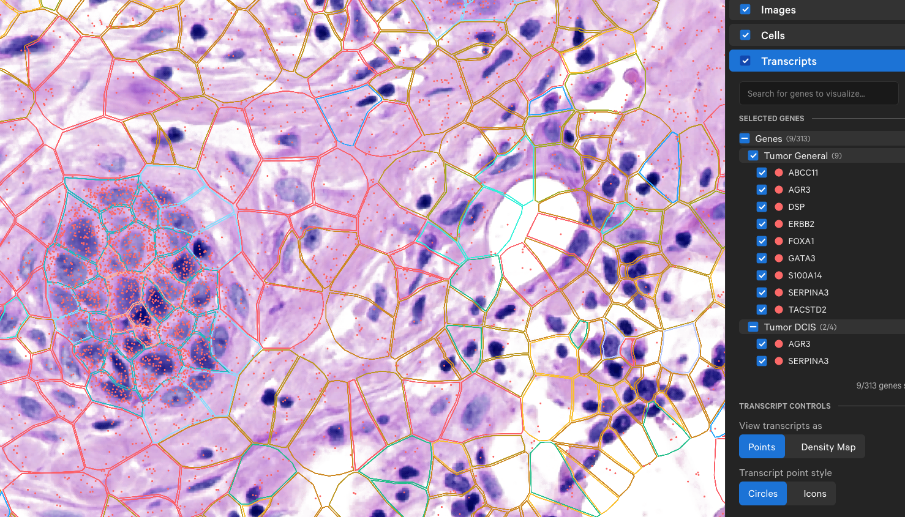

### VisiumHD

Today we will take a look into VisiumHD data and explore how different it is from the previous Visium.

The data I am using in this tutorial is available at 10x Genomics website:
https://www.10xgenomics.com/datasets/visium-hd-cytassist-gene-expression-libraries-human-breast-cancer-ff-ultima
Here, you can download "Binned outputs (all bin levels) - 20 GB" to get all the output files from the VisiumHD run.


```{r load_libraries, warning=FALSE}
library(Seurat)
library(ggplot2)
library(patchwork)
library(dplyr)
```


We will load the downloaded data now. Here we have binning options we can use. See here about an overview of VisiumHD capture area
and how the "HD spots" look like: https://cdn.10xgenomics.com/image/upload/v1713545308/blog/Visium%20HD%20NPI/Visium%20HD%20slides.png

```{r vishd_load}
# We choose here only 16um binning for performance reasons
vishd <- Load10X_Spatial(data.dir = "visiumhd", bin.size = 16)

# Check the assay
Assays(vishd)
# It is possible to load in multiple binnings as different assay. If we do that
# we can set the default assay we want to work with as follows:

#DefaultAssay(vishd) <- "Spatial.008um"

# The technology itself gives 2um binning and merges them into 8um bins. If you
# have a powerful computer (>16 GB memory), you can try with 8um bins as well!

```

We check the 'count's and 'feature's. What do these show?
Compared to the previous Visium data, what do we see below? What is different and what is similar?

```{r vishd_initial_plots, message = FALSE}

# First, plot the counts from VisiumHD data
VlnPlot(vishd, features = "nCount_Spatial.016um", pt.size = 0) + theme(axis.text = element_text(size = 8)) + NoLegend()
SpatialFeaturePlot(vishd, features = "nCount_Spatial.016um") + theme(legend.position = "right")

# Second, plot the features. What kind of effects can we expect from the differences we see?
VlnPlot(vishd, features = "nFeature_Spatial.016um", pt.size = 0) + theme(axis.text = element_text(size = 8)) + NoLegend()
SpatialFeaturePlot(vishd, features = "nFeature_Spatial.016um") + theme(legend.position = "right")

```

EPCAM is an epithelial cell marker and PTPRC shows the immune hotspots 

```{r visualize_genes}
# We can visiualize the genes on the visium slide the same way as before
p1 <- SpatialFeaturePlot(vishd, features = "EPCAM", slot = "counts") + ggtitle("EPCAM expression (16um)")
p2 <- SpatialFeaturePlot(vishd, features = "PTPRC", slot = "counts") + ggtitle("PTPRC expression (16um)")

p1 | p2
```
Since the object size is getting bigger and bigger with each analysis, I will subset the data
here to allow easier processing. There are methods in Seurat package that allows you to use
disk space to reduce the memory usage but we will not use it in this tutorial.

```{r subset, message=F}
# First getting the coordinates so that we can subset
coords <- GetTissueCoordinates(vishd)

# Afterwards, convert the pixel locations to rows and cols
# that will match the image resolution
scale_factor <- vishd@images$slice1.016um@scale.factors$lowres
coords_px <- coords %>% 
  mutate(
    imagecol = round(x * scale_factor),  # x -> pixel‐col
    imagerow = round(y * scale_factor),  # y -> pixel‐row
    tissue   = TRUE
  )

# Then the dimensions of the image
img <- vishd@images$slice1.016um@image
img_dims <- dim(img)
width  <- img_dims[1]
height <- img_dims[2]

# Getting the bottom left corner of the image since it looks more interesting
x_min <- floor(width  / 2) + 1
x_max <- width
y_max <- floor(height / 2) + 1
y_min <- 1

# Get the spots from that region
spots_to_keep <- coords_px %>%
  filter(imagerow   >= x_min,
         imagerow   <= x_max,
         imagecol   >= y_min,
         imagecol   <= y_max,
         tissue == TRUE) %>%
  pull(cell)

# Subset

vishd_tr <- subset(vishd, cells = spots_to_keep)

# vishd_tr@images$slice1.016um@image <- vishd@images$slice1.016um@image
# vishd_tr@images$slice1.016um@imageDim <- c(ncol(cropped), nrow(cropped))

SpatialFeaturePlot(vishd_tr, features = "EPCAM", crop = F, slot = "counts") + ggtitle("EPCAM expression (16um)")
```
I remove the old object here just to make sure it's not in the memory anymore

```{r remove_vishd}
print(ncol(vishd))
rm(vishd)
print(ncol(vishd_tr))
save(vishd_tr, file = "vishd_trimmed.RData")
```

There is different method to represent the data as well. See the sketch method:
https://www.nature.com/articles/s41587-023-01767-y
Beware that no statistical imputation is 100% accurate:
https://ars.els-cdn.com/content/image/1-s2.0-S2405471219301528-gr5_lrg.jpg
There is also a Seurat tutorial about the usage of sketch:
https://satijalab.org/seurat/articles/seurat5_sketch_analysis
For now, we will keep our subset but sketching can be more useful 
in real-life scenarios.

We will normalize the data now. There are different methods to do this, but for this tutorial
we will go with log-normalization.

```{r normalization}
vishd_tr <- NormalizeData(vishd_tr, normalization.method = "LogNormalize")
```

```{r visualize_genes_again}
# We can visiualize the genes on the visium slide the same way as before
p1 <- SpatialFeaturePlot(vishd_tr, features = "EPCAM", crop = F) + ggtitle("EPCAM expression (16um)")
p2 <- SpatialFeaturePlot(vishd_tr, features = "PTPRC", crop = F) + ggtitle("PTPRC expression (16um)")

p1 | p2
```
We will continue with clustering and finding the marker genes.
This part is the same as before, we first find the variable features, then
continue with PCA -> Neighbors -> Clusters. Then we use UMAP to further reduce
the dimensions of the data.

```{r variable_features, message=FALSE}
# Here I will check the variable features. Why do I do this and not the
# FindSpatiallyVariableFeatures()?
vishd_tr <- FindVariableFeatures(object = vishd_tr)
```

What would be different if I ran FindSpatiallyVariableFeatures() instead?

```{r pca}
vishd_tr <- ScaleData(vishd_tr)
vishd_tr <- RunPCA(vishd_tr, features = VariableFeatures(vishd_tr))
## What did I skip here?? Any ideas?
vishd_tr <- FindNeighbors(vishd_tr, dims = 1:50)
```


For clustering, we might have to try different resolutions.

```{r, clustering}
vishd_tr <- FindClusters(vishd_tr, resolution = 0.1)
vishd_tr <- RunUMAP(vishd_tr, seed.use = 42, dims = 1:50)
```

```{r, plot_umap}
 DimPlot(vishd_tr, reduction = "umap", label = T, group.by = "seurat_clusters")
```
Does the UMAP look good? Do you think there should be more or less clusters?

```{r, spatial_umap}
SpatialDimPlot(vishd_tr, label = TRUE, label.size = 3, crop = F)
```

From here onwards, we can continue with the downstream analyses.
Ideally, it would be more beneficial to apply spatial methods. In this
tutorial, we are limited by the computational resources we can use therefore
we keep it as light as possible by applying single-cell methods.

Take home message from this is, it is important to be aware of the data you
are generating with the technology you are using. In the Visium tutorial
we had around 5k spots. In this tutorial, our subset has around 60k.
This gives us a much better resolution and coverage, at the expense of
computational power.

Please also take a look at this data:
https://www.10xgenomics.com/products/xenium-in-situ/human-breast-dataset-explorer
Open this in Xenium Explorer Demo to see the difference between VisiumHD
and Xenium.



Xenium is a completely different technology, but it still provides high
resolution spatial transcriptomics data like VisiumHD. What are the
main differences between the two technologies? What are the limitations?

In the Xenium data, we have around 167k cells that were detected and
segmented by the Xenium software as opposed to VisiumHD's 146k spots. 
We can use Xenium Explorer tool to explore the data from any Xenium experiment. 
We can align the H&E image, see the (segmented) cell boundaries and see the 
detected transcripts. Here we see as an example some tumor markers:



While there are specialized tools and packages to directly load the
Xenium data into, if we have the segmentation information, we can easily
load this data into any spatial transcriptomics environment to go on with
the downstream analyses. Our columns would be the segmented cells, and rows
would be the genes that were detected; just like in single-cell, Visium or
VisiumHD data.

Good luck in the exam :)
